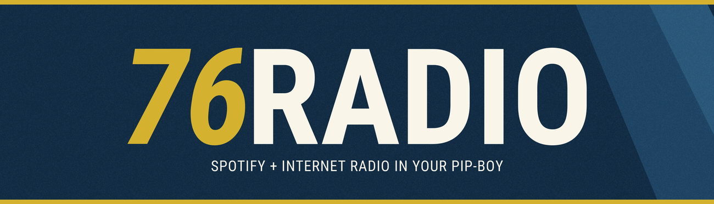

# 76Radio



76Radio adds Spotify controls and internet radio to the Fallout 76 Pip-Boy RADIO tab. A `Spotify Radio` entry joins the game's own stations, your own stream list sits below a divider, and a now-playing panel shows the track, artist, artwork and transport controls. A matching HUD card can appear beside the game's notifications.

There is no companion application, no account login and no server. Spotify is controlled through the Windows media session that the desktop client already publishes, and internet stations play through the Windows media pipeline. The mod is client side, gameplay neutral and reversible.

## Features

- `Spotify Radio` in the RADIO list, selectable with the keyboard, controller or mouse.
- Play, pause, previous and next through the Spotify desktop client.
- Track title, artist, album, elapsed time and playback state.
- Album artwork from the Windows media session, with the radio wave strip as a fallback.
- A seekable progress bar for Spotify tracks.
- Custom internet stations from a JSON file, with a divider between the game's stations and yours.
- A starter list of 20 tested internet stations, so the tab is populated on first launch.
- ICY song metadata from stations that broadcast it.
- Automatic handover: starting a station pauses Spotify, and returning to Spotify or a game station closes the stream.
- An active marker on the station that is playing.
- A HUD now-playing card that follows the Pip-Boy colour.
- An optional persistent mini player instead of the timed card.
- An INI file for logging, polling and UI options.

The mod does not change game files, game networking or gameplay values. It does not read Spotify credentials, use the Spotify Web API or capture audio.

## Requirements

| Requirement | Needed for |
| --- | --- |
| Fallout 76 on Windows 10 or 11 | The game |
| [xScal](https://github.com/DCHoaxer/xScal) installed as `dxgi.dll` beside `Fallout76.exe` | Required. 76Radio stores its documents in xScal's folder |
| [HUDModLoader](https://github.com/GitCrazy-wc/hudmodloader) | The HUD card and the transport relay behind the Pip-Boy buttons |
| The Spotify desktop client | The `Spotify Radio` entry |
| An internet connection | Internet stations only |

xScal is required. Without it the panel reports the bridge as offline and the mod cannot work. HUDModLoader is required for the HUD card and for the transport relay behind the PREV, PLAY/PAUSE and NEXT buttons; the panel still shows the track and artwork without it. Neither dependency is included in this package.

## Installation

Close Fallout 76 before installing or deploying.

### With Vortex

1. Install xScal first and let Vortex deploy it, so `dxgi.dll` sits beside `Fallout76.exe`.
2. Install the 76Radio zip in Vortex. Double-click the mod to open its details panel, set **Mod Type** to **Engine Injector**, then deploy. The default **Data** type would put the archive under `Data` but also put `version.dll` there, instead of beside `Fallout76.exe`.
3. Deploy the mod.
4. Make the two required ini edits below. Vortex does not edit `Fallout76Custom.ini` or `hudmodloader.ini` for you.

### By hand

1. Open the zip, select everything and drag it into the Fallout 76 folder, the one containing `Fallout76.exe` (typically `...\steamapps\common\Fallout76`), and allow it to merge with the existing `Data` folder. The zip already follows the game folder layout, so nothing needs moving into `Data` by hand.
2. Add `76Radio.ba2` to `sResourceArchive2List` in the `[Archive]` section of `Documents\My Games\Fallout 76\Fallout76Custom.ini`. Create the section and the key if they are missing, and keep the archives already listed.
3. If HUDModLoader is installed, add `76RadioHud` on its own line in `Data\hudmodloader.ini`. HUDModLoader loads only the SWFs named in that file, so without the line the HUD card and the transport relay do not load. `Data\interface\76RadioHud.swf` is already in place from the zip. If you do not use HUDModLoader, skip this step.
4. Optionally edit `Data\XSCAL\76Radio\76Radio.ini` for logging, polling and UI options. Without changes the module uses its defaults, and an update should not overwrite it.
5. Edit `Data\modsdata\76radio\stations.json` to add your stations. Keep an existing list when updating.
6. If a `version.dll` already sits beside `Fallout76.exe`, stop and find out which mod owns it. Two mods cannot share that filename, and 76Radio must be the one that ships it.
7. Start the game, open the Pip-Boy and select the RADIO tab. `Spotify Radio` appears at the end of the game's stations, above the divider.

A Vortex install also needs the archive list entry and, with HUDModLoader, the `hudmodloader.ini` line. Vortex does not edit the game's ini files.

### Language archives

These are optional. Add the matching archive to `sResourceArchive2List` only if the station names or track titles you listen to are written in that language, since the radio panel needs the characters to display them:

- `SeventySix - Interface_ja.ba2` for Japanese
- `SeventySix - Interface_ko.ba2` for Korean
- `SeventySix - Interface_zhhans.ba2` for Simplified Chinese
- `SeventySix - Interface_zhhant.ba2` for Traditional Chinese
- `SeventySix - Interface_ru.ba2` for Russian

All five ship with the game, not with 76Radio, and most players need none of them. English uses the font the game already loads.

The same steps are repeated in `INSTALL.txt` inside the release package.

### Checking that it loaded

- Select `Spotify Radio`. The panel shows live data when Spotify is playing, or a clear unavailable state when it is not.
- Look for `Data\XSCAL\76Radio\76Radio.log` in the game folder. It is rewritten on every launch and names the documents the module reads and writes.
- If the panel reports the bridge as offline, the module did not load. Check that `version.dll` is beside `Fallout76.exe` and that the game was not already running when it was copied.

### Uninstalling

In Vortex, remove the mod and deploy again. For a manual install, delete `Data\76Radio.ba2`, `Data\interface\76RadioHud.swf` and `version.dll`. Either way, remove `76Radio.ba2` from `sResourceArchive2List`, remove the `76RadioHud` line from `Data\hudmodloader.ini`, and optionally delete `Data\XSCAL\76Radio` and `Data\modsdata\76radio`. Removing the command documents in `Data\modsdata` is optional; they are small and the module recreates what it needs.

## Configuration

Settings live in `Data\XSCAL\76Radio\76Radio.ini` and are read once, when the game starts. Every entry is optional, and a missing file means the defaults. Delete a line, or the file, to reset it.

```ini
[Logging]
Enabled=1
MaxKb=1024

[Media]
StartupDelayMs=4000
PollIntervalMs=900

[Channel]
PollIntervalMs=150

[UI]
ShowStatus=0
ShowArtStatus=0
ShowArtwork=1
KeepNowPlaying=0
```

Booleans accept `1/0`, `true/false`, `on/off` and `yes/no`. Out-of-range intervals are clamped: media polling 100 to 60000 ms, command polling 20 to 5000 ms, start delay 0 to 60000 ms, and the log size 16 to 65536 KB, where `0` disables rotation. `KeepNowPlaying=1` keeps the card on screen while a track plays and becomes a persistent mini player; it still steps aside while a game notification is visible.

`[Logging] Enabled=0` stops 76Radio writing its log at all. The log is truncated at the start of each launch and rotates once to `76Radio.log.1`, so the pair stays bounded.

### Stations

`Data\modsdata\76radio\stations.json` is a small JSON file:

```json
{
  "stations": [
    { "name": "Classic FM", "streamurl": "https://ice-sov.musicradio.com/ClassicFMMP3" },
    { "name": "Radio Dismuke", "streamurl": "http://stream1.radiodismuke.com:8078/;stream.mp3" }
  ]
}
```

The package ships with this starter list of 20 tested stations. Edit or replace them as you like. Names and addresses are read as text. Entries with no name or no HTTP or HTTPS address are skipped, and the rest of the list still loads. The page and the module re-read the file when it changes, so stations can be edited while the game is running.

A station can be started and stopped, but not paused or seeked. A dropped station is retried a few times before the panel reports it stopped. ICY titles appear only when the station sends them; Ogg stations frequently advertise the station name without song metadata.

## Building from source

The native code and the ActionScript are public so that the module can be inspected and rebuilt rather than trusted as a binary.

### Prerequisites

- Windows 10 or 11 x64, Visual Studio 2026 with the Desktop development with C++ workload, and CMake 3.25 or later.
- Python 3 for the archive tools.
- Java for FFDec.
- [JPEXS Free Flash Decompiler](https://github.com/jindrapetrik/jpexs-decompiler/releases) with `ffdec-cli.jar` at `tools\vendor\ffdec\ffdec-cli.jar`.
- [Apache Flex SDK 4.16.1](https://archive.apache.org/dist/flex/4.16.1/binaries/apache-flex-sdk-4.16.1-bin.tar.gz) extracted to `work\flex`, plus the Flash Player 32.0 `playerglobal.swc` at `frameworks\libs\player\32.0\playerglobal.swc`. Pass another location with `-FlexHome`.
- Fallout 76 installed. The patched radio page is compiled from the player's own `SeventySix - Interface.ba2`.

The HUD relay also needs the shared HUDModLoader ActionScript classes. `scripts\build-hud.ps1` downloads them into `src\scaleform\hud` from the HUDModLoader repository if they are absent. They are third-party source, not part of 76Radio, and are not committed here.

```powershell
powershell -ExecutionPolicy Bypass -File scripts\build.ps1
```

That configures and builds with CMake, runs the native tests, compiles `76RadioHud.swf` with Flex, applies `src\scaleform\pipboy` to the extracted radio page with FFDec, checks the recompiled script, packs `dist\76Radio.ba2`, verifies the archive and writes `dist\build-manifest.json`.

The relay can be rebuilt on its own after editing the HUD source:

```powershell
powershell -ExecutionPolicy Bypass -File scripts\build-hud.ps1
```

Direct CMake build and tests:

```powershell
cmake --preset msvc-release
cmake --build --preset msvc-release
ctest --preset msvc-release
```

For a package, after a successful build:

```powershell
powershell -ExecutionPolicy Bypass -File scripts\package.ps1
```

The package contains only installed files: the archive, the loose HUD relay, `version.dll`, the settings and station templates, `INSTALL.txt`, `LICENSE.txt`, and `dist\SHA256SUMS.txt`. It refuses to pack an artifact whose hash no longer matches the build manifest.

The deployment, verification and uninstall scripts are optional convenience tools for a local installation. They detect the game through Steam, the Bethesda.net install, an Xbox install or a running process, and accept `-GameRoot` when it lives elsewhere. They refuse to overwrite files they do not own, back up what they replace and record what they installed. The root level module is deliberately not installed unless it is named:

```powershell
powershell -ExecutionPolicy Bypass -File scripts\deploy.ps1 -AllowRootModule version.dll
```

## Why version.dll?

`Fallout76.exe` imports `version.dll`, a normal Windows library. Windows resolves that name from the game folder before the system folder, so a module with that name loads at start-up without an injector, a loader change or a hook. Several other modules in the installation import the same name.

76Radio's `version.dll` forwards all seventeen entry points of the system library to the real `C:\Windows\System32\version.dll`, resolved at call time. The proxy answers were compared with the system library call by call, including filled version blocks and language names. The media runtime is separate from the forwarding code, and `DllMain` does no blocking work: it starts one worker and lets the worker read settings and open the documents.

The source for all of it is in `src\native\surface` and `README-TECHNICAL.md`. Anyone who does not want to run a prebuilt module can compile the same code with the steps above.

The 0.1.0 build has SHA-256 `5E0AEFE6A9B7843615ACE018580F5C2EBB122977CE76BCD175D9619E31A3D495`, and a [VirusTotal report](https://www.virustotal.com/gui/file/5e0aefe6a9b7843615ace018580f5c2ebb122977ce76bcd175d9619e31a3d495) is available for that exact file. VirusTotal reported 0 of 70 vendors flagging it when checked on 30 October 2026. Check that the report hash matches the `version.dll` you downloaded. A scan is not a guarantee of safety, which is why the source is published and can be rebuilt.

A root level module still carries risk that an archive-only interface mod does not. It is client side, it does not read game memory, patch game files, modify networking or bypass a signature check, but it does run inside the game process. Whether to install it is the player's decision.

## Compatibility and limitations

- The mod replaces the whole `newpipboy_radiopage.swf` with a page compiled from the installed game archive. Another mod that replaces the same page will conflict. The deployment script detects that case.
- The panel and archive are built against a particular game version. A game update can change the page or the interface archive, so use the package built for the installed version rather than forcing an old archive in place.
- Only one radio source plays at a time. Starting a stream pauses Spotify; starting a game station closes the stream.
- Internet stations cannot be paused or seeked. The panel's control stops them.
- ICY metadata depends on the station. Missing metadata is shown as the station name, not invented.
- Transport buttons and the HUD card need HUDModLoader. The page still shows track and artwork without the relay, but commands have no route.
- Occasionally the RADIO page is blank the first time the Pip-Boy opens. Closing and reopening the Pip-Boy shows it normally. The cause has not been identified.
- The mod has no volume control. Use Windows or Spotify.
- The mod has not been tested against every game update, every HUD or Pip-Boy replacer, or every proxy DLL that might claim `version.dll`. Do not run two mods with that filename.
- Fallout 76 is an online game. The module is client side and does not provide a gameplay advantage, but use of any process-resident module remains the player's choice.

## Source and contributions

The repository is [github.com/patrickJnr/76Radio](https://github.com/patrickJnr/76Radio). The source is published so the implementation can be read, audited and built locally. Issues and pull requests are welcome; see [CONTRIBUTING.md](CONTRIBUTING.md). Report security problems privately through [SECURITY.md](SECURITY.md), not in a public issue. The licence is the [PolyForm Noncommercial License 1.0.0](LICENSE). It is source-available and permits noncommercial use, but it is not an OSI open source licence.

Third-party tools, shared ActionScript and the origin of the patched page script are recorded in [THIRD-PARTY-NOTICES.md](THIRD-PARTY-NOTICES.md). The architecture, protocol and build pipeline are described in [README-TECHNICAL.md](README-TECHNICAL.md). Release steps, including the VirusTotal upload and the text that must match the new hash, are in [RELEASING.md](RELEASING.md).

## Credits

- HUDModLoader and its shared HUD ActionScript, by GitCrazy-wc.
- xScal, by DCHoaxer, which provides the document store.
- JPEXS Free Flash Decompiler and the Apache Flex SDK, used to build the interface files.
- Fallout 76 and its interface belong to Bethesda Game Studios.

## AI disclosure

AI assistants were used for research during development: looking up Windows media and Scaleform behaviour, comparing implementation options and checking documentation. They were a research aid, not the source of the mod. The code, assets and release decisions were reviewed and remain the project owner's responsibility.

## Disclaimer

76Radio is an unofficial mod. It is not endorsed by Bethesda, Microsoft, Spotify or the authors of xScal or HUDModLoader. Fallout 76 assets are not redistributed; the patched page is built from the player's own installation. Spotify is controlled only through the media session that the desktop client publishes, with no account access, tokens or audio capture.
