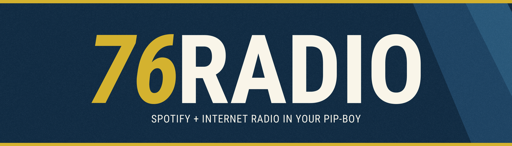

# 76Radio



76Radio adds Spotify controls and internet radio to the Fallout 76 Pip-Boy RADIO tab. It is an unofficial mod that loads through [xScal](https://www.nexusmods.com/fallout76/mods/4183).

- A `Spotify Radio` entry joins the game's own stations, with the track, artist, album, artwork and transport controls.
- Your own internet stations sit below a divider, from a plain JSON file you can edit while the game runs.
- A now-playing card on the HUD follows your Pip-Boy colour, and you can move it in game.

There is no companion application, no account login and no server. Spotify is controlled through the Windows media session the desktop client already publishes. Internet stations play through the Windows media player. The mod does not change game files, game networking or gameplay values, and it does not read Spotify credentials, use the Spotify Web API or capture audio.

## Contents

- [Quick start](#quick-start)
- [In game controls](#in-game-controls)
- [Configuration](#configuration)
- [Stations](#stations)
- [Spotify, Windows Media and playback states](#spotify-windows-media-and-playback-states)
- [Installation details](#installation-details)
- [Compatibility and limitations](#compatibility-and-limitations)
- [Building from source](#building-from-source)
- [Source, credits and disclaimer](#source-credits-and-disclaimer)

## Quick start

1. Install xScal 0.4.22 or later so `dxgi.dll` sits beside `Fallout76.exe`, and optionally [HUDModLoader](https://www.nexusmods.com/fallout76/mods/3144) for the HUD card.
2. Copy the 76Radio package into the Fallout 76 folder, merging the `Data` folder. Vortex does this for you.
3. Add `76Radio.ba2` to `sResourceArchive2List` in `Documents\My Games\Fallout 76\Fallout76Custom.ini`, and add `76RadioHud` on its own line in `Data\hudmodloader.ini`.
4. Start the game, open the Pip-Boy and select the RADIO tab. `Spotify Radio` is at the end of the game's stations, and the starter stations are below the divider.

Full steps, language archives, checking that it loaded, and uninstalling are under [Installation details](#installation-details).

### Requirements

| Requirement | Needed for |
| --- | --- |
| Fallout 76 on Windows 10 or 11 | The game |
| [xScal](https://www.nexusmods.com/fallout76/mods/4183) 0.4.22 or later, as `dxgi.dll` beside `Fallout76.exe` | Required. Loads the plugin and stores its documents |
| [HUDModLoader](https://www.nexusmods.com/fallout76/mods/3144) | The HUD card, the hotkeys and the buttons on the Pip-Boy page |
| The Spotify desktop client | The `Spotify Radio` entry only |

The in-game hotkeys and the card editor use xScal's input calls. They were checked against xScal 0.4.27. Without those calls the card stays where the game's notifications are and the hotkeys do nothing; the rest of the mod is unaffected.

## In game controls

These work with the Pip-Boy closed. They need HUDModLoader and `76RadioHud` in `hudmodloader.ini`.

| Action | Default keys | Setting |
| --- | --- | --- |
| Play or pause | CTRL + SHIFT + P | `[Hotkeys] PlayPause` |
| Next track | CTRL + SHIFT + N | `[Hotkeys] Next` |
| Previous track | CTRL + SHIFT + B | `[Hotkeys] Previous` |
| Show or hide the now-playing card | CTRL + SHIFT + U | `[Hotkeys] ToggleCard` |
| Move the now-playing card | CTRL + SHIFT + L | fixed |

Hotkeys control Spotify or the selected media player. An internet station is a live stream, so play, pause, next and previous do not apply to it. Hiding the card lasts until you press the key again or restart the game.

### Moving the card

Press CTRL + SHIFT + L. The card appears with a frame and a hint, and the mouse is captured.

- Hold the left mouse button and drag to move it.
- Turn the mouse wheel to change the size, and hold SHIFT while turning it to change the opacity.
- Right click to put it back in the default place, size and opacity.
- Press CTRL + SHIFT + L again to save and leave.

On a controller, press the left bumper, right bumper and Y together to start and stop, and move the card with the right stick. The D-pad up and down change the size, and left and right change the opacity. The game's own stick and D-pad input is suppressed while you edit.

The position, size and opacity are stored in `Data\modsdata\r76radio.layout.json` and apply straight away, with no restart. The position is an offset from the game's notification area. A size or opacity set this way overrides `CardScale` and `CardOpacity` in the ini, which are only the defaults. Delete the file, or right click in the editor and save, to go back to the ini values. CTRL + SHIFT + L is separate from the SHIFT + Backspace layout editor in Improved Bars, so both can be installed.

## Configuration

Settings live in `Data\XSCAL\76Radio\76Radio.ini` and are read once, when the game starts. Every entry is optional, and a missing file means the defaults. Delete a line, or the file, to reset it. The full file with comments is `config\76Radio.ini`.

```ini
[UI]
KeepNowPlaying=0
CardScale=100
CardOpacity=100
HideInVats=0
ShowArtwork=1
ShowStatus=0
ShowArtStatus=0

[Hotkeys]
PlayPause=CTRL+SHIFT+P
Next=CTRL+SHIFT+N
Previous=CTRL+SHIFT+B
ToggleCard=CTRL+SHIFT+U

[Media]
StartupDelayMs=4000
PollIntervalMs=900

[Channel]
PollIntervalMs=150

[Logging]
Enabled=1
MaxKb=1024
```

| Setting | Effect |
| --- | --- |
| `Logging Enabled`, `MaxKb` | `Enabled=0` stops the log. The log restarts on every launch and rotates once to `76Radio.log.1` at the size limit, 16 to 65536 KB, where `0` disables rotation |
| `Media StartupDelayMs`, `PollIntervalMs` | How long to wait before asking Windows for Spotify (0 to 60000 ms) and how often to ask (100 to 60000 ms) |
| `Channel PollIntervalMs` | How often the module looks for a command from the Pip-Boy, 20 to 5000 ms |
| `UI ShowStatus`, `ShowArtStatus` | Panel diagnostics. Off in the normal radio UI |
| `UI ShowArtwork` | `0` hides the album artwork and leaves the wave strip in its place |
| `UI KeepNowPlaying` | `1` keeps the card on screen as a mini player instead of a seven second toast. It still steps aside while a game notification is visible |
| `UI CardScale` | Default card size as a percentage, 50 to 200. The in-game editor can override it |
| `UI CardOpacity` | Default card opacity as a percentage, 20 to 100. The in-game editor can override it |
| `UI HideInVats` | `1` hides the card while VATS is active. The game does not tell the HUD about other combat |
| `Hotkeys` | Keys joined with `+`. Letters, digits, F1 to F12, NUM0 to NUM9, SPACE, LEFT, UP, RIGHT, DOWN, CTRL, SHIFT and ALT are understood. An empty or unrecognised entry turns that hotkey off |

Booleans accept `1/0`, `true/false`, `on/off` and `yes/no`. Out-of-range numbers are clamped.

## Stations

Stations are managed by editing `Data\modsdata\76radio\stations.json`. Save the file and the list refreshes within a few seconds, even with the game running.

```json
{
  "stations": [
    { "name": "Classic FM", "streamurl": "https://ice-sov.musicradio.com/ClassicFMMP3" },
    { "name": "Radio Dismuke", "streamurl": "http://stream1.radiodismuke.com:8078/;stream.mp3" }
  ]
}
```

To add a station, copy one `{ ... }` line, change the `name` and `streamurl`, and keep a comma between entries but not after the last one. To remove one, delete its line.

The package ships a starter list of 20 stations so the tab is populated on first launch. An update never overwrites your `stations.json`, and a 0.1.0 list works unchanged.

- `name` is the text shown in the list and may contain any characters. Add the matching [language archive](#language-archives) if the font does not show them. Quote marks and backslashes must be escaped as `\"` and `\\`.
- `streamurl` must start with `http://` or `https://`. Entries with no name, a bad address or a repeated address are skipped, and the rest of the list still loads. At most 256 stations are read.
- Direct HTTP and HTTPS audio streams that Windows can play (MP3, AAC, Ogg), M3U and M3U8 playlists and PLS playlists are accepted. Playlists are followed through redirects and each entry is tried in turn, within limits of 256 KB, 32 entries, two levels and five redirects.
- HLS playlists are handed to Windows unchanged and carry no ICY metadata.

Whether a given station URL stays online is outside the mod's control, and the starter list is not a guarantee. A station that cannot be reached shows `FAILED`, and the list then marks it `[OFFLINE]`. The mark is kept between sessions in `Data\modsdata\76radio\r76radio.health.json`, and it is removed the next time that station plays. It is only a hint: you can still select the station and try again. Delete the file to clear every mark.

## Spotify, Windows Media and playback states

`Spotify Radio` controls Spotify and nothing else. Play, pause, previous, next and seeking go through the Windows media session. The panel disables any control the session does not allow.

A separate entry named after the application it finds (`Chrome`, `Edge`, `Firefox`, `Brave`, `Opera`, `VLC` or `Media Player` for the common ones, otherwise `Windows Media`) controls another player that publishes a Windows media session. It is marked [BETA]: not every application publishes a session, and Edge did not appear when tried. Select it to take the session Windows treats as active, ignoring Spotify. With several players open, click the `SOURCE: name >` line to move to the next. If the application closes, the panel reports no session instead of switching to another.

Internet stations report what the player is really doing:

| State | Meaning |
| --- | --- |
| `CONNECTING` | The address is being resolved and opened |
| `BUFFERING` | Windows is filling its buffer. `PLAYING` is shown only once audio is playing |
| `RECONNECTING` | The stream dropped. A fresh connection is tried after 2, 4, 8 and 16 seconds |
| `FAILED` | The station cannot be reached or stopped responding |
| `UNSUPPORTED` | The station answers but Windows cannot decode what it sends |
| `STOPPED` | You stopped it or moved to another source |

Address lookups run on a background thread, so a slow or dead station does not freeze the Pip-Boy. A station can be started and stopped but not paused or seeked. ICY song titles appear only when the station sends them, in UTF-8, Windows-1252 or ISO-8859-1 text. Only one source plays at a time: starting a station pauses Spotify, and returning to Spotify or a game station closes the stream. Internet stations follow the game's Pip-Boy Radio and master volume sliders; Spotify and other sessions keep their own volume.

## Installation details

Close Fallout 76 before installing.

### With Vortex

1. Install xScal first and deploy it, so `dxgi.dll` sits beside `Fallout76.exe`.
2. Install the 76Radio zip in Vortex and deploy it. Every file is relative to the game folder, including the plugin and its signature under `Data\XSCAL\Plugins`.
3. Make the two ini edits below. Vortex does not edit the game's ini files.

### By hand

1. Open the zip, select everything and drag it into the Fallout 76 folder, the one containing `Fallout76.exe`, merging the `Data` folder. The zip already has the right layout.
2. Add `76Radio.ba2` to `sResourceArchive2List` in the `[Archive]` section of `Documents\My Games\Fallout 76\Fallout76Custom.ini`, keeping the archives already listed. Create the section and key if they are missing.
3. If HUDModLoader is installed, add `76RadioHud` on its own line in `Data\hudmodloader.ini`. HUDModLoader loads only the SWFs named there, so without the line the HUD card, the hotkeys and the Pip-Boy buttons do not load.
4. Optionally edit `Data\XSCAL\76Radio\76Radio.ini`.
5. If an old 76Radio `version.dll` from 0.1.0 is still beside `Fallout76.exe`, delete it. The plugin replaced that host, and leaving both in place makes two media hosts fight over the same documents.
6. Start the game, open the Pip-Boy and select the RADIO tab.

`INSTALL.txt` inside the release package repeats these steps.

### Updating

- Your `stations.json` is never overwritten, and a list from 0.1.0 or 0.2.0 works unchanged.
- Replace `76Radio.dll` and `76Radio.dll.sig` together. xScal rejects a DLL whose signature does not match.
- From 0.2.0, `76Radio.ini` gains new sections. A missing section uses its defaults, so nothing breaks. Copy the packaged file over yours to see every option, then re-apply any value you changed.
- From 0.1.0, delete the old `version.dll` from the game folder.

### Language archives

Optional. Add the matching archive to `sResourceArchive2List` only if the station names or track titles you listen to are in that language:

- `SeventySix - Interface_ja.ba2` for Japanese
- `SeventySix - Interface_ko.ba2` for Korean
- `SeventySix - Interface_zhhans.ba2` for Simplified Chinese
- `SeventySix - Interface_zhhant.ba2` for Traditional Chinese
- `SeventySix - Interface_ru.ba2` for Russian

They ship with the game, not with 76Radio, and most players need none of them.

### Checking that it loaded

- Select `Spotify Radio`. The panel shows live data when Spotify is playing, or a clear unavailable state when it is not.
- `Data\XSCAL\76Radio\76Radio.log` is rewritten on every launch. Its first line gives the 76Radio version, and the settings it read follow.
- `xscal.log` beside `Fallout76.exe` has a line naming 76Radio that says whether the plugin loaded or why it was rejected. A missing or stale `.sig`, an unsigned build or a certificate mismatch all appear there.
- If the panel reports the bridge as offline, the plugin did not load.

### Uninstalling

In Vortex, remove the mod and deploy again. For a manual install, delete `Data\76Radio.ba2`, `Data\interface\76RadioHud.swf`, `Data\XSCAL\Plugins\76Radio.dll` and `Data\XSCAL\Plugins\76Radio.dll.sig`. Either way, remove `76Radio.ba2` from `sResourceArchive2List` and the `76RadioHud` line from `hudmodloader.ini`. Your stations, settings and card position are left behind in `Data\modsdata` and `Data\XSCAL\76Radio`, and you can delete them too.

## Compatibility and limitations

- The mod replaces the whole `newpipboy_radiopage.swf` with a page compiled from the installed game archive. Another mod that replaces the same page will conflict.
- The panel is built against a particular game version. A game update can require a new build, so use the package for the installed version.
- Internet stations cannot be paused or seeked. ICY metadata depends on the station, and missing metadata is shown as the station name, not invented.
- The `Windows Media` entry works only with applications that publish a media session, and switching between sessions uses the mouse.
- Transport buttons, hotkeys and the HUD card need HUDModLoader. The page still shows track and artwork without it.
- Occasionally the RADIO page is blank the first time the Pip-Boy opens, and closing and reopening it shows it normally. The cause has not been identified. 0.3.0 rebuilds the list when it finds the page on screen with no entries, and records that in the log if it happens.
- The card editor with mouse and controller, including size and opacity, the media hotkeys, the card size, opacity and VATS settings and the offline marks have been used in game.
- Windows only. The plugin uses Windows media sessions and the Windows media player. It has not been tried under Proton or Wine, and Spotify control there would need a different route.
- Not tested against every game update, HUD or Pip-Boy replacer, or xScal release. xScal rejects the plugin when its signature is missing or does not match the DLL, so a DLL and its `.sig` must always be replaced together.
- Fallout 76 is an online game. The module is client side and does not provide a gameplay advantage, but use of any process-resident module remains the player's choice.

### Why an xScal plugin

76Radio used to ship a `version.dll` proxy. The native module is now an ordinary xScal plugin, `Data\XSCAL\Plugins\76Radio.dll`, loaded by the extender the player already installed. xScal loads only signed plugins, so the build signs the DLL and writes `76Radio.dll.sig` next to it. The plugin runs inside the game process. It does not read game memory, patch game files or change networking, but you should install it only if you are comfortable with that. Each release lists the SHA-256 of the package and the DLL in `SHA256SUMS.txt`; check that they match your download. A signature does not prove the code is safe, which is why the source is published. `README-TECHNICAL.md` describes the loading, threading and document contract.

## Building from source

The native code and the ActionScript are public so the module can be inspected and rebuilt. The maintainer's signing key and certificate are private, so a build from this repository cannot produce a `76Radio.dll` that xScal will load under the `patrickjnr_76radio` ID. You can still:

- Build and test every native library with `-DBUILD_XSCAL_PLUGIN=OFF`. `scripts\ci.ps1` does this.
- Compile the HUD relay with `scripts\build-hud.ps1` and the Pip-Boy page with `scripts\build.ps1 -SkipNative`.
- Build the plugin against the xScal SDK without signing, which xScal rejects but proves the source compiles.
- Run a fork under your own certificate and author prefix from the xScal maintainer, changing `kPluginId` and signing your own build.

Prerequisites: Windows 10 or 11 x64, Visual Studio with the C++ workload, CMake 3.25 or later, Python 3, Java, [JPEXS Free Flash Decompiler](https://github.com/jindrapetrik/jpexs-decompiler/releases) at `tools\vendor\ffdec\ffdec-cli.jar`, [Apache Flex SDK 4.16.1](https://archive.apache.org/dist/flex/4.16.1/binaries/apache-flex-sdk-4.16.1-bin.tar.gz) in `work\flex` with the Flash Player 32.0 `playerglobal.swc`, and Fallout 76 installed, because the patched page is compiled from your own `SeventySix - Interface.ba2`. The xScal plugin SDK is not redistributed; ask the xScal maintainer for it and point `XSCAL_PLUGIN_SDK_DIR` at its `cmake` folder. The shared HUDModLoader ActionScript is downloaded by `scripts\build-hud.ps1` and is third-party source.

```powershell
powershell -ExecutionPolicy Bypass -File scripts\build.ps1 -XScalSdk C:\xscal-sdk\sdk\cmake
```

That builds the plugin, runs the native tests, compiles the HUD relay and the Pip-Boy page, and packs `dist\76Radio.ba2` with a manifest. `scripts\package.ps1` then builds the release zip. `scripts\deploy.ps1`, `verify.ps1` and `uninstall.ps1` are optional tools for a local installation; deploy stops if the game is running. Direct CMake use:

```powershell
cmake --preset msvc-release -DXSCAL_PLUGIN_SDK_DIR=C:\xscal-sdk\sdk\cmake
cmake --build --preset msvc-release
ctest --preset msvc-release
```

The architecture, protocol and build pipeline are described in [README-TECHNICAL.md](README-TECHNICAL.md).

## Source, credits and disclaimer

The repository is [github.com/patrickJnr/76Radio](https://github.com/patrickJnr/76Radio), under the PolyForm Noncommercial 1.0.0 licence, so the source can be read, built and modified for noncommercial use but is not an OSI open source licence. Issues and pull requests are welcome; see [CONTRIBUTING.md](CONTRIBUTING.md). Unofficial third-party binaries or redistributed releases are not maintained or endorsed by the project owner. Third-party tools and shared ActionScript are recorded in [THIRD-PARTY-NOTICES.md](THIRD-PARTY-NOTICES.md).

- HUDModLoader and its shared HUD ActionScript, by GitCrazy-wc: [Nexus Mods 3144](https://www.nexusmods.com/fallout76/mods/3144).
- xScal, by DCHoaxer, which loads the plugin and provides the document store: [Nexus Mods 4183](https://www.nexusmods.com/fallout76/mods/4183).
- JPEXS Free Flash Decompiler and the Apache Flex SDK, used to build the interface files.
- Fallout 76 and its interface belong to Bethesda Game Studios.

AI assistants were used for research during development: looking up Windows media and Scaleform behaviour, comparing implementation options and checking documentation. They were a research aid, not the source of the mod.

76Radio is an unofficial mod. It is not endorsed by Bethesda, Microsoft, Spotify or the authors of xScal or HUDModLoader. Fallout 76 assets are not redistributed. No Spotify account access, tokens or audio capture.
